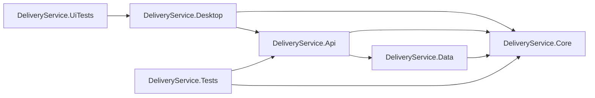
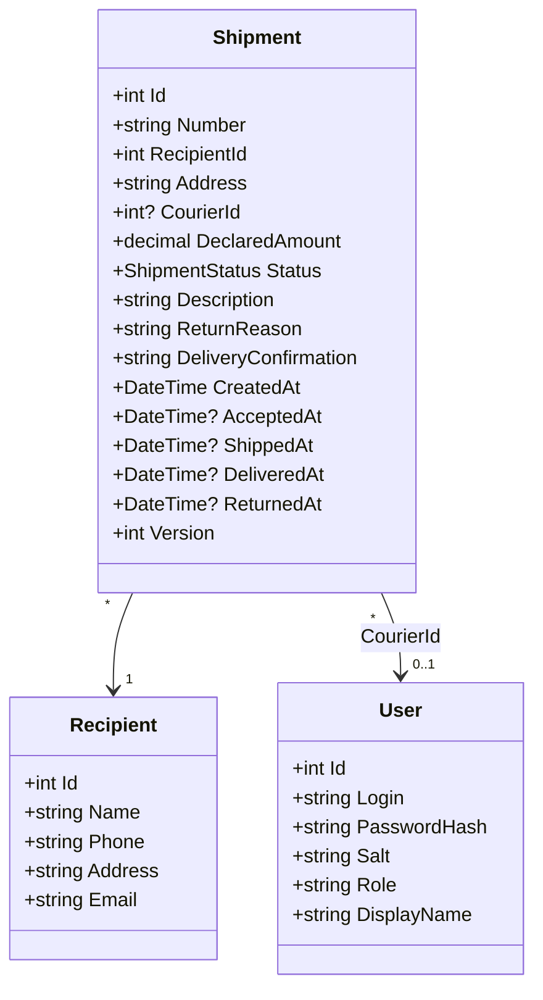

# Архитектура службы доставки

УП.02, вариант 5, работа 2, занятия 4 и 5.

Решение построено на .NET 10 как решение `DeliveryService.slnx` из шести проектов. Разделение построено на следующем принципе: правила предметной области не зависят от способа их хранения и отображения; клиент общается с сервером только через HTTP API.

## Модули решения

| Проект | Вид | Ответственность | Зависимости проекта |
|---|---|---|---|
| `DeliveryService.Core` | Библиотека классов | Сущности `Shipment` и `Recipient`, перечисления статусов и ролей, правила переходов, DTO, формирование и разбор CSV/JSON/XML | — |
| `DeliveryService.Data` | Библиотека классов | EF Core, контекст SQLite, миграции, начальные данные, запросы хранения | `DeliveryService.Core` |
| `DeliveryService.Api` | ASP.NET Core | Маршруты REST, JWT и роли, проверка прав на уровне объекта, ошибки `ProblemDetails`, журнал сервера | `DeliveryService.Core`, `DeliveryService.Data` |
| `DeliveryService.Desktop` | WPF | Окно входа, рабочее окно, модели представления, HTTP-клиент, запуск локального API | `DeliveryService.Core`; запуск встроенного хоста `DeliveryService.Api` для текущего профиля |
| `DeliveryService.Tests` | xUnit | Модульные тесты правил Core и интеграционные тесты API на чистой SQLite | `DeliveryService.Core`, `DeliveryService.Api` |
| `DeliveryService.UiTests` | xUnit + FlaUI | Запуск собранного Desktop.exe и проверка окон по `AutomationId` | Собранное приложение `DeliveryService.Desktop` |

### Правила зависимостей

1. `DeliveryService.Core` не ссылается ни на один другой проект решения. В нём нет кода EF Core, ASP.NET Core и WPF.
2. `DeliveryService.Desktop` не обращается к SQLite и не содержит бизнес-правил смены статусов. Все данные приходят через HTTP-клиент, а при запуске из WPF сервер поднимается как локальный процесс.
3. Зависимости направлены только в одну сторону — от внешнего слоя к внутреннему. Циклы и обратные ссылки (`Core → Data`, `Api → Desktop`) запрещены; после перехода к двум процессам проектная ссылка Desktop на Api может быть удалена.

## Интерфейсы модулей

| Контракт | Операции | Кто определяет | Кто реализует и использует |
|---|---|---|---|
| HTTP REST API | Вход и выход, отправления, получатели, курьеры, пользователи, статистика, экспорт, проверка здоровья | `DeliveryService.Api` | Api предоставляет, Desktop вызывает через `DeliveryClient` |
| DTO и модели | `LoginInput`, `LoginResponse`, `ShipmentInput`, `ShipmentInfo`, `TransitionInput`, `RecipientInput`, `RecipientInfo`, `CourierInfo`, `UserInfo`, `StatisticsInfo`, `ImportResult` | `DeliveryService.Core` | Api и Desktop используют одни и те же типы |
| Правила отправления | `CanTransition`, `ApplyTransition`, `ValidateReturnReason`, `BuildStatistics` | `DeliveryService.Core` | Api проверяет при каждом запросе, Data сохраняет результат |
| Хранилище отправлений | `GetShipments`, `GetShipment`, `CreateShipment`, `UpdateShipment`, `TransitionShipment` | `DeliveryService.Data` | Реализация в Data, клиент — Api |
| Хранилище получателей | `GetRecipients`, `CreateRecipient`, `UpdateRecipient`, `ImportRecipients` | `DeliveryService.Data` | Реализация в Data, клиент — Api |
| Доступ к пользователям | `FindByLogin`, `GetUsers`, `GetCouriers`, `RevokeToken` | `DeliveryService.Data` | Реализация в Data, клиент — Api |

## Структура папок и точки входа

| Папка | Основные файлы |
|---|---|
| `DeliveryService.Core` | `Entities/Shipment.cs`, `Entities/Recipient.cs`, `Enums/ShipmentStatus.cs`, `Enums/UserRole.cs`, `Rules/ShipmentRules.cs`, `Dto/`, `Exchange/ShipmentExporter.cs`, `Exchange/RecipientCsvParser.cs` |
| `DeliveryService.Data` | `DeliveryDbContext.cs`, `Stores/ShipmentStore.cs`, `Stores/RecipientStore.cs`, `Stores/UserStore.cs`, `Migrations/`, `Seed/DemoData.cs` |
| `DeliveryService.Api` | `Program.cs`, `DeliveryHost.cs`, `Endpoints/AuthEndpoints.cs`, `Endpoints/ShipmentEndpoints.cs`, `Endpoints/RecipientEndpoints.cs`, `Endpoints/UserEndpoints.cs`, `Security/TokenService.cs`, `Security/RevokedTokens.cs` |
| `DeliveryService.Desktop` | `App.xaml.cs`, `Views/LoginWindow.xaml`, `Views/WorkspaceWindow.xaml`, `ViewModels/`, `Services/DeliveryClient.cs` |
| `DeliveryService.Tests` | `Core/ShipmentRulesTests.cs`, `Core/ExportImportTests.cs`, `Api/ShipmentApiTests.cs`, `Api/AuthApiTests.cs`, `Fixtures/TestHost.cs` |
| `DeliveryService.UiTests` | `LoginWindowTests.cs`, `WorkspaceWindowTests.cs`, `Fixtures/DesktopFixture.cs` |
| `docs` | Требования, архитектура, спецификация API, проверки API, тест-кейсы, чек-лист интерфейса, руководство пользователя |
| `artifacts` | Диаграммы, файл запросов `requests.http`,_example CSV, результаты проверок |

Точка входа сервера — `Program.cs` проекта `DeliveryService.Api`. Точка входа клиента — `App.xaml.cs` проекта `DeliveryService.Desktop`: при запуске создаётся `LoginWindow`, а после успешного входа открывается `WorkspaceWindow`.

## Модель данных

Одно отправление ссылается на одного получателя; один получатель может иметь несколько отправлений. Курьер назначается на отправления и видит только их. Роль хранится в учётной записи как строка со значениями `Admin`, `Operator`, `Courier` и совпадает с именами в контрактах API.

## API-взаимодействие

Базовый адрес при отдельном запуске — `https://localhost:7130` (профиль `Local`). При запуске из WPF API поднимается на свободном локальном порту, и клиент получает его адрес при старте. Все ответы — JSON в camelCase; ошибки — `ProblemDetails` (`application/problem+json`).

Последовательность типичного запроса:

1. Desktop отправляет `POST /api/auth/login` с логином и паролем и сохраняет JWT.
2. Каждый следующий запрос несёт заголовок `Authorization: Bearer <token>`.
3. Api проверяет токен, роль и, для курьера, принадлежность объекта; при нарушении прав возвращает 401 или 403, для чужого отправления — 404.
4. Api вызывает правила Core, затем хранилище Data; Data сохраняет запись и увеличивает `version`.
5. При устаревшей версии Data возвращает признак конфликта, а Api превращает его в ответ 409.

Маршрут `GET /api/shipments/export` объявлен раньше `GET /api/shipments/{id}`: литеральная часть `export` имеет приоритет над параметром, поэтому запрос экспорта не может быть воспринят как запрос карточки с идентификатором `export`. Полная спецификация маршрутов приведена в [api-spec.md](api-spec.md), а компоновка модулей — в [requirements.md](requirements.md).
